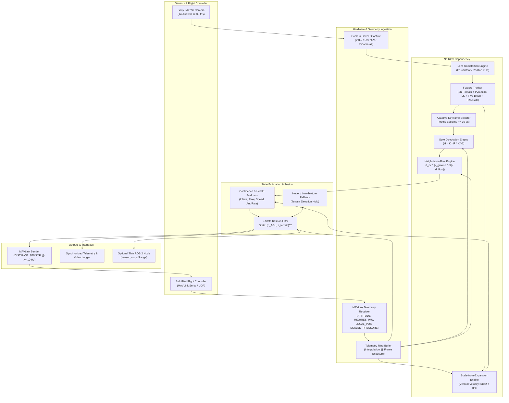

# Visual Positioning System (VPS) - Phase 1: Height (AGL) Estimator
## System Architecture & Mathematical Specification

---

### 1. High-Level System Architecture

The VPS Phase 1 system estimates Above Ground Level (AGL) height by fusing downward-looking monocular vision with flight controller telemetry.



---

### 2. Mathematical Formulations & Coordinate Frames

#### 2.1 Coordinate Frames
- **World Frame ($W$)**: Local NED (North-East-Down) or geographic frame.
- **Body Frame ($B$)**: Drone structural frame (X forward, Y right, Z down).
- **Camera Frame ($C$)**: Optical frame with Z forward (downward relative to drone), X right, Y down.
- **Image Plane**: Pixel coordinates $(u, v)$ with origin at top-left.

#### 2.2 Pinhole Optics & Ground Sample Distance (GSD)
For calibrated focal lengths $(f_x, f_y)$ and AGL altitude $H$:
$$GSD_x = \frac{H}{f_x}, \quad GSD_y = \frac{H}{f_y}$$
At max altitude $H = 300\text{ m}$ and $f_x \approx 1207\text{ px}$:
$$GSD \approx \frac{300}{1207} \approx 0.2485\text{ m/px} \approx 25\text{ cm/px}$$

#### 2.3 Gyro-Based Frame De-Rotation
Between keyframe $t_k$ and current frame $t_c$, relative camera rotation $R_{k \to c} \in SO(3)$ is obtained by integrating high-rate gyro angular velocities $\boldsymbol{\omega}_{IMU}$:
$$R_{k \to c} = \exp\left( \int_{t_k}^{t_c} [\boldsymbol{\omega}_C(t)]_\times dt \right)$$
The infinite homography mapping pixels from frame $t_k$ to $t_c$ induced solely by rotation is:
$$H_{rot} = K R_{k \to c} K^{-1}$$
For feature point $\mathbf{p}_k$ in keyframe $k$, its purely rotated position in current frame is:
$$\tilde{\mathbf{p}}_{k,derot} = H_{rot} \tilde{\mathbf{p}}_k$$
The residual image displacement between tracked feature $\mathbf{p}_c$ and $\tilde{\mathbf{p}}_{k,derot}$ is purely translational:
$$\Delta \mathbf{p}_{trans} = \mathbf{p}_c - \mathbf{p}_{k,derot}$$

#### 2.4 Height from Keyframe De-Rotated Optical Flow
Given ground displacement $\Delta \mathbf{d}_{ground} = \int_{t_k}^{t_c} \mathbf{v}_{ground}(t) dt$ (from EKF ground velocity):
$$H = f_{px} \cdot \frac{\|\Delta \mathbf{d}_{ground}\|}{\|\Delta \mathbf{p}_{trans}\|}$$
To maintain high signal-to-noise ratio:
- Keyframes are triggered when accumulated baseline ground distance guarantees $\|\Delta \mathbf{p}_{trans}\| \ge 10\text{ px}$.
- At $300\text{ m}$ altitude and $10\text{ m/s}$ speed, $10\text{ px}$ corresponds to $\Delta d \approx 2.48\text{ m}$ ($\Delta t \approx 0.25\text{ s}$).

#### 2.5 Scale from Feature Expansion during Climb/Descent
During vertical climb or descent ($\Delta H = H_1 - H_2 \ne 0$), image scale expands or contracts.
For feature pairs $(i, j)$ with distances $d_1(i, j)$ at $t_1$ and $d_2(i, j)$ at $t_2$:
$$\text{Scale Ratio } s = \frac{s_1}{s_2} = \frac{\text{median}(d_1)}{\text{median}(d_2)} = \frac{H_2}{H_1}$$
With barometric altimetry difference $\Delta H = H_1 - H_2$ (independent of terrain):
$$H_1 = \frac{\Delta H}{1 - s_1/s_2}, \quad H_2 = H_1 - \Delta H$$

#### 2.6 2-State Kalman Filter Formulation
State vector:
$$\mathbf{x} = \begin{bmatrix} h_{AGL} \\ z_{terrain} \end{bmatrix}$$
Where baro-referenced altitude $a = h_{AGL} + z_{terrain}$.

**State Prediction**:
Driven by down-velocity $v_D$ from flight controller:
$$\begin{bmatrix} \dot{h}_{AGL} \\ \dot{z}_{terrain} \end{bmatrix} = \begin{bmatrix} -v_D \\ 0 \end{bmatrix} + \mathbf{w}$$
$$\mathbf{F} = \begin{bmatrix} 1 & 0 \\ 0 & 1 \end{bmatrix}, \quad \mathbf{B} = \begin{bmatrix} -\Delta t \\ 0 \end{bmatrix}, \quad \mathbf{Q} = \begin{bmatrix} q_{h} \Delta t & 0 \\ 0 & q_{terrain} \Delta t \end{bmatrix}$$

**Measurement Models**:
1. **Barometer Altitude**:
   $$z_{baro} = \begin{bmatrix} 1 & 1 \end{bmatrix} \mathbf{x} + v_{baro}$$
2. **Vision Height Measurement** (from Flow or Scale Expansion):
   $$z_{vis} = \begin{bmatrix} 1 & 0 \end{bmatrix} \mathbf{x} + v_{vis}$$
   where measurement covariance $R_{vis}$ is scaled dynamically by inverse confidence $\frac{1}{\text{conf}^2}$.

**Degraded / Hover Mode**:
When vision confidence falls below threshold (e.g. forward speed $< 0.5\text{ m/s}$ and no vertical motion, or feature count $< 15$):
- Vision updates are disabled.
- Terrain elevation $z_{terrain}$ is held constant with gradual covariance inflation $q_{terrain}$.
- Output height is propagated as $h_{AGL} = a_{baro} - z_{terrain}$.

---

### 3. Software Modular Decomposition

```
e:\VPS\
├── config/
│   ├── default_config.yaml       # Master configuration (camera, mavlink, tracker, kf)
│   ├── imx296_calib_default.yaml # Default intrinsics (fx 1207, fy 1199, etc.)
│   └── sitl_params.param         # ArduPilot parameter reference for distance sensor
├── vps/
│   ├── __init__.py
│   ├── config.py                 # Dataclasses & YAML schema loader
│   ├── camera/
│   │   ├── __init__.py
│   │   ├── capture.py            # Generic V4L2 / Mock video capture
│   │   └── calibration.py        # Checkerboard / ChArUco calibrator
│   ├── tracker/
│   │   ├── __init__.py
│   │   ├── feature_tracker.py    # Shi-Tomasi + LK optical flow + forward-backward
│   │   └── keyframe_manager.py   # Adaptive baseline keyframe selector
│   ├── geometry/
│   │   ├── __init__.py
│   │   ├── pinhole.py            # Undistort, reprojection, GSD
│   │   ├── derotation.py         # SO(3) integration & homography K*R*K^-1
│   │   ├── height_flow.py        # Height from de-rotated optical flow
│   │   └── scale_expansion.py    # Height from vertical expansion ratio
│   ├── mavlink/
│   │   ├── __init__.py
│   │   ├── connection.py         # Async MAVLink reader/writer (pymavlink)
│   │   ├── telemetry_buffer.py   # Interpolation ring buffer for timestamp matching
│   │   └── distance_sender.py    # DISTANCE_SENSOR message formatter
│   ├── fusion/
│   │   ├── __init__.py
│   │   ├── kalman_filter.py      # 2-state EKF [h_agl, z_terrain]
│   │   └── confidence.py         # Multi-factor confidence metric
│   ├── tools/
│   │   ├── __init__.py
│   │   ├── logger.py             # High-speed telemetry + frame sync logger
│   │   ├── replayer.py           # Log playback engine
│   │   ├── simulator.py          # Synthetic aerial pinhole simulator
│   │   ├── focus_inspector.py    # Infinity-focus verification tool
│   │   ├── baseline_calibrator.py# Ground baseline height offset calibration
│   │   └── aruco_validator.py    # Low-altitude (< 30 m) ground truth validator
│   └── ros2/                     # Thin optional ROS 2 node wrapper
│       ├── __init__.py
│       └── vps_node.py
├── tests/
│   ├── __init__.py
│   ├── test_geometry.py          # Unit tests for pinhole, derotation, height formulas
│   ├── test_tracker.py           # Unit tests for LK flow & keyframing
│   ├── test_kalman.py            # Unit tests for 2-state filter & terrain hold
│   ├── test_mavlink.py           # Unit tests for MAVLink packing & ring buffer
│   └── test_sim_altitude.py      # Automated benchmark across 30 m to 300 m
├── ARCHITECTURE.md
├── PLAN.md
└── RULES.md
```

---

### 4. Hardware Constraints & Timing Budgets

| Metric | Target | Rationale |
| :--- | :--- | :--- |
| **Camera FPS** | 30 fps (33.3 ms/frame) | Sony IMX296 hardware framerate |
| **Processing Budget** | $\le 25\text{ ms/frame}$ | Enables $\ge 25\text{ fps}$ throughput on Raspberry Pi 5 / Jetson Orin |
| **End-to-End Latency**| $< 100\text{ ms}$ | Shutter exposure midpoint to MAVLink `DISTANCE_SENSOR` dispatch |
| **MAVLink Output Rate**| $10 - 20\text{ Hz}$ | ArduPilot rangefinder driver optimal ingestion rate |
| **Telemetry Ingest Rate**| $\ge 50 - 100\text{ Hz}$ | Required for accurate gyro inter-frame de-rotation integration |
| **Altitude Dynamic Range**| $0.1\text{ m}$ to $300\text{ m}$ AGL | Hand-held baseline ($0.1-2\text{ m}$) up to max flight ceiling ($300\text{ m}$) |

