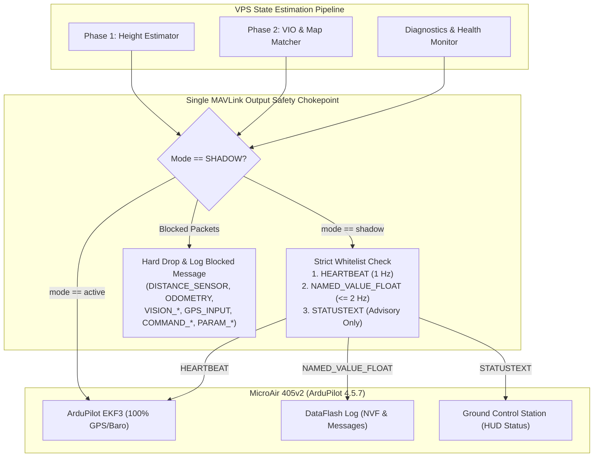
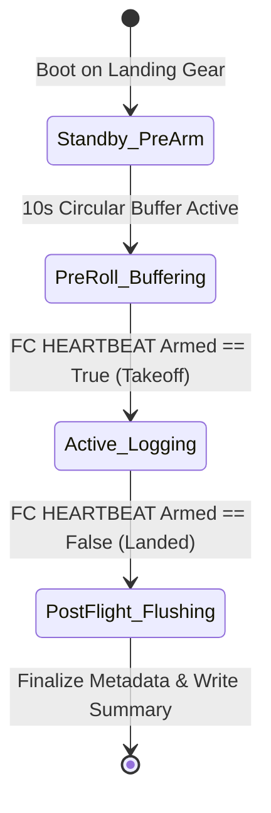

# Visual Positioning System (VPS) — Shadow Mode Plan (`SHADOW_PLAN.md`)
## Live Observe-Only Evaluation & Ground-Truth Verification Framework

**Author**: Senior Robotics & State-Estimation Engineer  
**Target Hardware**: Raspberry Pi 5 (Quad Cortex-A76 @ 2.4 GHz, MicroSD Card storage) + Sony IMX296 Global Shutter Camera  
**Flight Controller**: MicroAir 405v2 (ArduPilot 4.5.7, UART @ 921,600 baud)  
**Primary GNSS**: MicroAir GPS (Standard single-frequency GNSS, non-RTK)  
**Flight Test Center**: `19.808798° N, 75.283380° E` (1.0 km radius, Aurangabad, Maharashtra)  
**Initial Flight Envelope**: 0 to 50 m AGL (gradual ladder: 10m, 20m, 35m, 50m)  
**Ground Clearance**: Calibrated 6 cm (0.06 m) camera-to-ground landing gear baseline (No ArUco fiducials needed)  
**Document Status**: Approved Operational Context — Executing Milestone S1  

---

## 1. Executive Summary & Core Principle

**The Core Principle of Shadow Mode is strict, physically unbreachable observe-only operation.**

During Shadow Mode:
1. The drone flies **100% normally on its standard GPS/RTK, compass, and barometer setup** under pilot control.
2. The Raspberry Pi 5 companion computer passively captures live camera frames, receives telemetry, executes the full real-time Phase 1 and Phase 2 estimation stack, records synchronized datasets to NVMe storage, and compares estimates against ground truth.
3. **The VPS is physically and architecturally incapable of influencing the flight controller.** Under no circumstances can VPS inject position, velocity, height, or commands into ArduPilot in this mode.

---

## 2. Safety Guards & Hard Requirements



### 2.1 Single Chokepoint Whitelist (`ShadowMAVLinkSafetyChokepoint`)
- All outbound MAVLink packet generation must pass through a single, non-bypassable chokepoint class.
- When `mode == "shadow"`, an immutable strict whitelist is applied:
  - **Permitted**:
    - `HEARTBEAT` (1 Hz) — announces companion computer presence.
    - `NAMED_VALUE_FLOAT` (max 2 Hz, e.g., `VPS_H`, `VPS_CONF`, `VPS_DRIFT`) — recorded into ArduPilot dataflash log (`NVF` table) and GCS status table for live pilot glance without feeding EKF.
    - `STATUSTEXT` (low rate, severity `MAV_SEVERITY_INFO`) — for critical warnings or lock status.
  - **Hard-Blocked (Dropped & Counter Incremented)**:
    - `DISTANCE_SENSOR` (#132)
    - `ODOMETRY` (#331)
    - `VISION_POSITION_ESTIMATE` (#102), `VISION_SPEED_ESTIMATE` (#103)
    - `GPS_INPUT` (#232)
    - All `COMMAND_LONG` (#76) and `COMMAND_INT` (#75)
    - All `PARAM_SET` (#23)
    - All `SET_POSITION_TARGET_*`
- **Unit Test Guarantee**: Isolated unit tests will inject all blocked packet types into the chokepoint and mathematically assert that zero bytes leave the serial/network buffer.

### 2.2 Configuration & Interlock Invariants
- `mode: shadow` is declared in `config.yaml` and embedded into the immutable header of every log file.
- Any attempt to set `feed_fc_ekf: true` or enable active outputs while `mode == shadow` raises an uncatchable `ConfigurationConflictError` on process startup.

### 2.3 Harmless Pi 5 Failure Modes
- The entire VPS process runs under a standalone hardware/software watchdog supervisor (`ShadowSupervisor`).
- A Pi 5 crash, kernel panic, camera disconnection, NVMe write bottleneck, thermal throttling, or undervoltage **only stops local logging**—the flight controller experiences zero UART bus flooding, zero interrupts, and zero flight mode changes.

### 2.4 Low-Rate Monitoring Telemetry
- Diagnostic streams to ArduPilot are limited to $\le 2\text{ Hz}$.
- Packets emit custom `NAMED_VALUE_FLOAT` tags:
  - `VPS_H`: Estimated AGL height (m).
  - `VPS_CONF`: Estimator confidence $[0.0, 1.0]$.
  - `VPS_V`: Metric horizontal ground speed (m/s).
  - `VPS_MM`: Map match status ($0=\text{searching}, 1=\text{locked}$).
- **Pilot Visibility**: Visible in Mission Planner / QGroundControl in the Quick / Status tab under `NAV_CONTROLLER_OUTPUT` / `NAMED_VALUE_FLOAT`.

---

## 3. Runtime Architecture & Auto-Flight Triggers



### 3.1 Arm-Triggered Session Lifecycle & 10s Pre-Roll Buffer
- **Standby & Pre-Roll**: On boot, VPS continuously writes camera frames and telemetry into a rolling in-memory ring buffer (10 seconds duration).
- **Auto-Start**: When ArduPilot's `HEARTBEAT.base_mode` transitions to `ARMED`, the recorder triggers, immediately flushes the 10-second pre-roll buffer to disk (capturing the stationary ground baseline and takeoff transition), and begins continuous session recording.
- **Auto-Stop**: When the drone disarms after landing, logging continues for 10 seconds (to capture touchdown dynamics), flushes all open file descriptors, computes session statistics, and safely closes the session directory.
- **Manual Override**: An RC channel switch or CLI command can force start/stop logging regardless of arm status.

### 3.2 Non-Blocking Asynchronous Disk Writer (SSD/NVMe)
- Raspberry Pi 5 runs with an NVMe base or high-speed USB3 SSD.
- Frame capture and state estimation run in real-time threads (Cores 0, 1, 2).
- An asynchronous queue dispatches raw image compression (TurboJPEG / PNG) and disk writing to Core 3.
- If storage write bandwidth ever dips, the graceful degradation ladder kicks in:
  1. Reduce map match search frequency ($2\text{ Hz} \to 0.5\text{ Hz}$).
  2. Drop frame disk recording from 30 FPS to 15 FPS while maintaining 30 FPS tracking in RAM.
  3. Log degradation event with timestamp and memory pressure statistics.

### 3.3 Crash-Safe Session Structure & Reproducibility Metadata
Every flight produces an isolated session directory:
```text
logs/shadow_sessions/
  └── session_20261124_143000_aurangabad_flight01/
        ├── session_meta.json          <-- Git hash, config hash, camera calibration, firmware version
        ├── preflight_report.json       <-- Preflight checklist results
        ├── telemetry_mavlink.parquet   <-- Chunked, time-synchronized FC telemetry
        ├── vps_estimates.parquet       <-- 30 Hz states, covariances, inlier stats, latencies
        ├── map_match_events.jsonl      <-- Every match attempt, inliers, peak, rejection reason
        ├── frames/                     <-- Synchronized JPEG frames (frame_000001.jpg)
        └── performance_summary.json    <-- Preliminary metrics generated on disarm
```
- **Session Metadata (`session_meta.json`)**: Contains git commit ID, git dirty status, exact YAML configuration hash, camera exposure/gain settings, IMU time offset, and airframe physical offsets ($6\text{ cm}$ baseline).

---

## 4. Phase 1 Shadow Evaluation (Height AGL)

### 4.1 Ground Truth Priority Hierarchy
To validate the Phase 1 height estimator ($10\text{ m}$ to $400\text{ m}$ AGL), ground truth is established through multi-sensor cross-reference:
1. **Low Altitude ($\le 30\text{ m}$)**: Physical landing-gear ground zero ($0.06\text{ m}$), ArUco calibrated fiducial marker passes, and precision hardware rangefinder (if equipped).
2. **Medium & High Altitude ($30\text{ m}$ to $400\text{ m}$)**: RTK / GNSS geodetic ellipsoidal height minus high-resolution DEM (Digital Elevation Model) terrain elevation profile.
3. **Takeoff-Relative Barometer Altimetry**: Used as an independent smooth sanity reference, cross-checked for thermal drift.

### 4.2 Segmented Metric Analysis
Evaluation is computed per altitude band:
- **Bands**: $0\text{–}30\text{ m}$, $30\text{–}60\text{ m}$, $60\text{–}120\text{ m}$, $120\text{–}200\text{ m}$, $200\text{–}300\text{ m}$, $300\text{–}400\text{ m}$.
- **Dynamics Segmentation**: Hover ($v_h < 0.5\text{ m/s}$), Cruise ($v_h \ge 0.5\text{ m/s}$), Steady Climb ($v_z < -0.5\text{ m/s}$), Steady Descent ($v_z > 0.5\text{ m/s}$).
- **Statistical Metrics**:
  - Mean Absolute Error (MAE) and Percent Error: $\frac{|h_{est} - h_{true}|}{h_{true}} \times 100\%$
  - Systematic Mean Bias: $\frac{1}{N}\sum (h_{est} - h_{true})$
  - Root Mean Square Error (RMSE)
  - 95th Percentile Maximum Error
  - Dropout Duration (seconds where confidence $< 0.30$ or vision rejected)
  - Confidence Calibration: Reliability diagram ($E[|error|] \text{ vs. reported confidence}$).
- **Root-Cause Tagging for Degraded Segments**:
  - Low surface texture / water / tarmac.
  - Excessive angular rates ($\|\boldsymbol{\omega}\| > 45^\circ/\text{s}$).
  - Time synchronization skew ($|\Delta t| > 5\text{ ms}$).
  - Atmospheric haze / low contrast.
  - Motion blur (exposure time $> 3\text{ ms}$).

---

## 5. Phase 2 Shadow Evaluation (Horizontal Positioning)

### 5.1 Real-Time Live Tracking Evaluation
- **Truth Source**: High-accuracy GNSS / RTK positioning from ArduPilot (`GLOBAL_POSITION_INT` / `GPS_RAW_INT`).
- **Real-Time Error Tracking**:
  - Live horizontal position error: $e_{2D}(t) = \|\mathbf{p}_{VPS,xy}(t) - \mathbf{p}_{GPS,xy}(t)\|$.
  - VIO Dead-reckoning drift rate: Meters drift per minute during pure dead reckoning.
  - Map matching fix residual: Absolute correction vector $\|\Delta \mathbf{p}_{fix}\|$ when a Sentinel-2 match lands.
  - Relocalization latency: Time taken to recover bounded error after tracking loss.

### 5.2 Post-Flight "Virtual GNSS Denial" Test
```text
Timeline:
[ 0m ------------ Takeoff & Climb (GPS Active) ------------ ]
                  |
             t = T_initial (GPS Cutoff Simulated in Replay)
                  |
                  |---> Run 1 min Virtual Denial  --> Measure Drift Growth & CEP
                  |---> Run 3 min Virtual Denial  --> Measure Drift Growth & CEP
                  |---> Run 5 min Virtual Denial  --> Measure Drift Growth & CEP
                  |---> Run 10 min Virtual Denial --> Measure Drift Growth & CEP
```
- Re-runs the recorded flight data offline through the identical estimator binaries.
- Simulates sudden total GPS denial at multiple arbitrary mission epochs (e.g., cruising at $100\text{ m}$, high-speed dash at $20\text{ m/s}$, stationary loiter).
- **Comparison Modes**:
  1. **VIO Only**: Free-running dead reckoning without map matching.
  2. **VIO + Map Matching**: Absolute periodic Sentinel-2 fixes bounding drift.
- **Metrics**: Circular Error Probable (CEP 50% and CEP 95%), Drift rate (% of distance traveled), and maximum excursion before map match reset.

### 5.3 Environmental & Seasonal Sensitivity Breakdown
- Performance categorized by:
  - Altitude band.
  - Ground speed ($0\text{–}5$, $5\text{–}12$, $12\text{–}20\text{ m/s}$).
  - Terrain classification (agricultural plots, rocky Deccan terrain, urban edges).
  - Time of day & lighting angle (solar shadows).
  - Seasonal appearance gap (live monsoon green vegetation vs. dry reference satellite tiles).

---

## 6. Suite of 6 Specialized Tools

| # | Tool Script | Primary Function | Output / Artifact |
|---|---|---|---|
| **1** | `vps/tools/preflight.py` | Hardware checklist: camera detection, lens focus/lock, exposure fixed, monotonic clocks, MAVLink rate verification, storage space, CPU temp, ArUco test. | Interactive terminal pass/fail + `preflight_report.json`. |
| **2** | `vps/tools/shadow_run.py` | Production daemon orchestrating supervised flight recording, pre-roll buffer, safe MAVLink chokepoint, and auto arm/disarm triggers. | Clean session directory with synchronized frames & telemetry. |
| **3** | `vps/tools/replay.py` | Offline replayer re-running recorded raw sensor feeds through the estimator pipeline. | Generates equivalence diff asserting $\le 0.01\%$ deviation from live runtime. |
| **4** | `vps/tools/evaluate.py` | Multi-flight analytics engine parsing session logs against GPS/DEM ground truth. | Computes all Phase 1 and Phase 2 error metrics, CEP, and bands. |
| **5** | `vps/tools/report_generator.py` | Formats evaluation results into rich visual reports. | Standalone interactive HTML report with trajectory map overlays, error graphs, and histograms. |
| **6** | `vps/tools/flightcard.py` | Generates printable pilot test cards for staged flight trials. | Formatted Markdown / PDF flight card specifying test steps, altitudes, and checklists. |

---

## 7. Pass / Fail Acceptance Criteria (YAML Configurable)

These parameters are declared in `config/shadow_criteria.yaml` and govern automated pass/fail verification:

```yaml
# Shadow Mode Acceptance Thresholds
phase1_height:
  max_mean_error_pct:
    band_0_30m: 8.0     # Max 8% error at low altitude
    band_30_60m: 6.0    # Max 6% error
    band_60_120m: 5.0   # Max 5% error
    band_120_200m: 5.0  # Max 5% error
    band_200_400m: 6.0  # Max 6% error at ceiling
  max_rms_error_m: 3.5
  max_dropout_pct: 2.0  # Max 2% of flight time without valid vision
  min_confidence_calibration_r2: 0.75

phase2_position:
  vio_only:
    max_drift_rate_pct_dist: 2.5   # Max 2.5% drift over distance traveled
    max_drift_mps: 0.35            # Max 0.35 m/s velocity drift
  vio_with_map_match:
    max_cep_50_m: 6.0              # 50% of positions within 6 meters
    max_cep_95_m: 12.0             # 95% of positions within 12 meters
    min_match_success_rate_pct: 60.0
    max_relocalization_time_s: 5.0

stage_gating:
  consecutive_clean_flights_to_pass: 3
```

---

## 8. Eight-Stage Execution Milestones

- **Milestone S1: Safety Chokepoint & Whitelist Isolation**: Implement single chokepoint `ShadowMAVLinkSafetyChokepoint`, config interlock, unit tests proving blocked messages cannot leak, and watchdog supervisor.
- **Milestone S2: High-Speed Session Recorder & Pre-Roll Engine**: Implement 10s pre-roll buffer, non-blocking asynchronous NVMe writer, auto arm/disarm triggers, and metadata JSON generation.
- **Milestone S3: Preflight Inspection & Flight Card Generator**: Build `preflight.py` hardware diagnostic suite and `flightcard.py` flight-day pilot briefing tool.
- **Milestone S4: Offline Replayer & Numerical Equivalence Test**: Build `replay.py` and regression test confirming that replaying raw session logs produces identical outputs to live flight.
- **Milestone S5: Phase 1 Height Analytics & Visualization**: Build Phase 1 evaluation module in `evaluate.py` with altitude band breakdown, error histograms, and confidence reliability curves.
- **Milestone S6: Phase 2 Positioning & Virtual GNSS Denial Engine**: Implement Phase 2 evaluation, virtual GPS denial simulator, CEP 50/95 calculator, and drift growth curves.
- **Milestone S7: End-to-End Simulation & Ground Rig Dry-Run**: Execute full automated dry-run using synthetic terrain simulator and real ArduPilot flight logs (`log_19`); tune pipeline.
- **Milestone S8: Flight-Day Operational Documentation & Deployment Guide**: Author comprehensive pilot handbook, troubleshooting guide, and systemd service profile for field trials.

---

